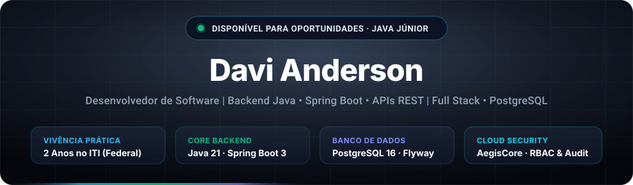
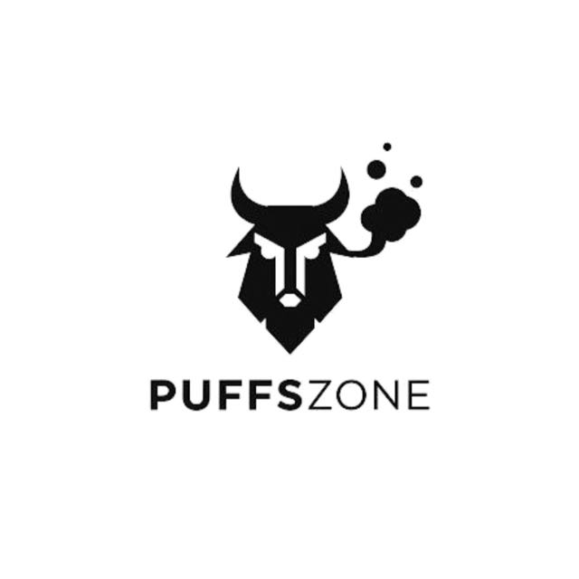
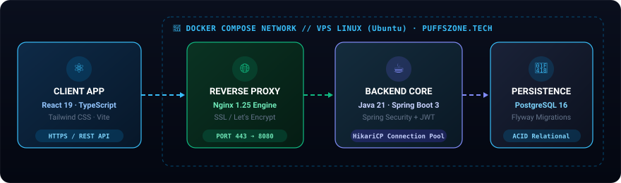
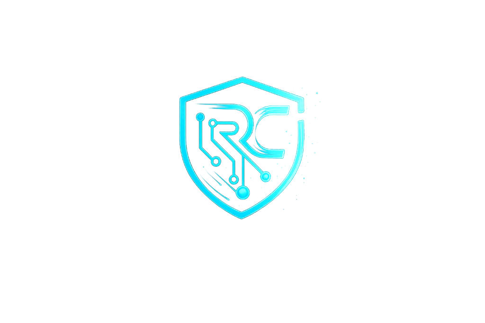
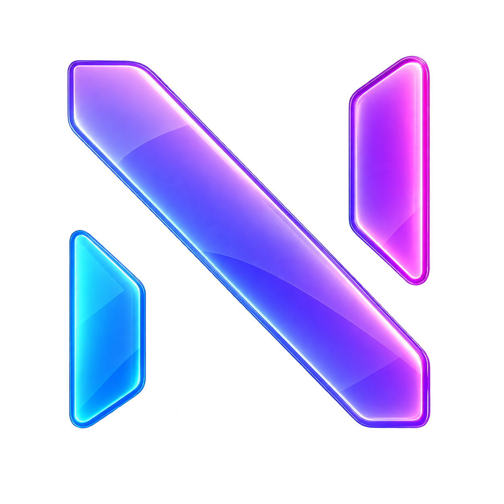
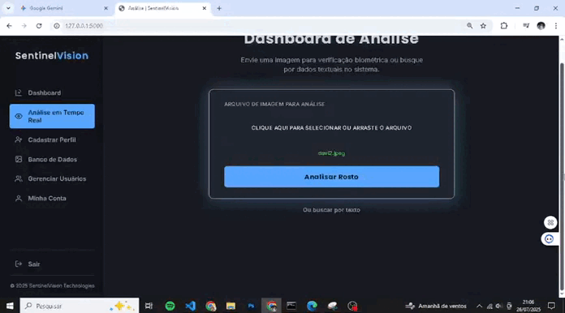

  

    

  

    
    
    
    
  

 

---

## 👨‍🚀 Sobre Mim & Telemetria do Sistema

| 🎯 Posicionamento | 🏛️ Vivência Prática | 🚀 Projeto Autoral | 🎓 Formação Acadêmica |
| :---: | :---: | :---: | :---: |
| **Backend Java Júnior** APIs RESTful & Microsserviços | **2 Anos no ITI (Federal)** 18m Dev Java + 6m DBA Postgres | **PuffsZone (Em Produção)** Java 21 · Spring 3 · React 19 · VPS | **Banco de Dados** UniCesumar (Prev. 02/2027) |

 

Desenvolvedor backend com **dois anos de experiência prática de estágio no Instituto Nacional de Tecnologia da Informação (ITI)**, autarquia federal vinculada à Casa Civil da Presidência da República:

* **18 meses em desenvolvimento com Java e Spring Boot**: Microsserviços, arquitetura limpa em camadas, APIs RESTful, testes automatizados (JUnit 5, Mockito), integração entre sistemas corporativos, autenticação/autorização stateless com **JWT**, criptografia (**RSA/AES**), controle de acesso por perfis (**RBAC**) e auditoria de ações críticas.
* **6 meses em administração de bancos de dados PostgreSQL**: Desenvolvimento SQL avançado (**procedures, triggers, views complexas, funções**), modelagem relacional, rotinas ETL e otimização contínua de consultas com planos de execução (`EXPLAIN ANALYZE`), alcançando **melhoria de latência em 40%**.

Autor e desenvolvedor do **[PuffsZone](https://puffszone.tech)**, sistema completo de gestão comercial e ponto de venda (PDV) publicado e operando em ambiente real de produção em VPS Linux com **Java 21, Spring Boot 3, React 19, TypeScript, PostgreSQL 16, Flyway e Docker Compose** sob proxy reverso Nginx e HTTPS.

 

  

 

---

## 💼 Experiência Profissional

<table width="100%">
  <tr>
    <td>
      

        
        
      

      <h3>🏛️ Estagiário em Desenvolvimento de Sistemas | Instituto Nacional de Tecnologia da Informação (ITI)</h3>
      
<em>Autarquia federal vinculada à Casa Civil da Presidência da República</em>

      <ul>
        <li><strong>Microsserviços & APIs REST:</strong> Concepção e evolução de APIs REST e integrações corporativas com <strong>Java</strong>, <strong>Spring Boot</strong> e <strong>Node.js</strong>, com testes automatizados (JUnit 5, Mockito) e arquitetura limpa em camadas.</li>
        <li><strong>DataProtection (LGPD):</strong> Atuação no desenvolvimento do sistema institucional de governança e proteção de dados pessoais: backend em Java/Spring Boot e interface em Angular.</li>
        <li><strong>Segurança & Criptografia:</strong> Implementação de autenticação/autorização com <strong>JWT</strong>, controle de acesso baseado em papéis (<strong>RBAC</strong>), criptografia <strong>RSA/AES</strong> e padrões de assinatura digital (<strong>ICP-Brasil, PKI</strong>).</li>
        <li><strong>Depuração & PostgreSQL:</strong> Análise de planos de execução (<code>EXPLAIN ANALYZE</code>) e otimização de consultas relacionais para resolução de gargalos de performance entre frontend e backend.</li>
        <li><strong>Bancos de Dados & Performance:</strong> Modelagem e administração de <strong>PostgreSQL</strong> e <strong>Elasticsearch</strong>, reduzindo a latência de consultas críticas em <strong>40%</strong>.</li>
        <li><strong>DevOps & CI/CD:</strong> Conteinerização com <strong>Docker</strong>, sustentação em ambientes <strong>Kubernetes</strong> e pipelines de integração e entrega contínua no <strong>GitLab CI/CD</strong>.</li>
      </ul>
      

        <strong>Tecnologias:</strong>
        <code>Java 21</code> • <code>Spring Boot</code> • <code>PostgreSQL</code> • <code>Docker</code> • <code>Kubernetes</code> • <code>JWT</code> • <code>RSA/AES</code> • <code>GitLab CI/CD</code> • <code>Angular</code> • <code>Node.js</code> • <code>Elasticsearch</code>
      

    </td>
  </tr>
</table>

 

<table width="100%">
  <tr>
    <td>
      

        
        
      

      <h3>🗄️ Estagiário em Administração de Banco de Dados | Instituto Nacional de Tecnologia da Informação (ITI)</h3>
      
<em>Autarquia federal vinculada à Casa Civil da Presidência da República</em>

      <ul>
        <li><strong>SQL Avançado:</strong> Desenvolvimento de rotinas SQL avançadas com <strong>procedures, triggers, views complexas e funções</strong> para integridade e manipulação de grandes volumes de dados corporativos.</li>
        <li><strong>Modelagem de Dados:</strong> Modelagem relacional conceitual, lógica e física, normalização de dados e administração de instâncias corporativas <strong>PostgreSQL</strong>.</li>
        <li><strong>ETL & Automação:</strong> Implementação e automação de pipelines de extração, transformação e carga (<strong>ETL</strong>) para alimentação e consolidação de bases institucionais.</li>
        <li><strong>Business Intelligence:</strong> Construção de relatórios gerenciais e dashboards analíticos de BI para suporte à tomada de decisão estratégica.</li>
        <li><strong>Monitoramento & Sustentação:</strong> Monitoramento contínuo de integridade, documentação técnica de esquemas e automação de rotinas de manutenção preventiva.</li>
      </ul>
      

        <strong>Tecnologias:</strong>
        <code>PostgreSQL</code> • <code>SQL Avançado</code> • <code>Procedures & Triggers</code> • <code>Modelagem Relacional</code> • <code>ETL</code> • <code>Business Intelligence</code> • <code>Automação</code>
      

    </td>
  </tr>
</table>

 

---

## 🛠️ Habilidades Técnicas & Arsenal

<table width="100%">
  <tr>
    <td width="50%" align="center" valign="top">
      <h4>☕ Linguagens & Core</h4>
        
      <code>Java 21</code> • <code>TypeScript</code> • <code>JavaScript</code> • <code>Python</code> • <code>Kotlin</code>
    </td>
    <td width="50%" align="center" valign="top">
      <h4>🚀 Backend & Frameworks</h4>
        
      <code>Spring Boot 3</code> • <code>APIs REST</code> • <code>Node.js</code> • <code>Express</code> • <code>FastAPI</code>
    </td>
  </tr>
  <tr>
    <td width="50%" align="center" valign="top">
      <h4>🐘 Bancos de Dados & Cache</h4>
        
      <code>PostgreSQL 16</code> • <code>Flyway</code> • <code>Redis</code> • <code>Elasticsearch</code> • <code>pgvector</code>
    </td>
    <td width="50%" align="center" valign="top">
      <h4>☁️ DevOps, Cloud & Infra</h4>
        
      <code>Docker Compose</code> • <code>Kubernetes</code> • <code>Linux VPS</code> • <code>Nginx</code> • <code>GitLab CI/CD</code>
    </td>
  </tr>
  <tr>
    <td colspan="2" align="center" valign="top">
      <h4>💻 Frontend & Interfaces Reativas</h4>
        
      <code>React 19</code> • <code>Angular</code> • <code>Next.js</code> • <code>Tailwind CSS</code> • <code>HTML5 & CSS3</code>
    </td>
  </tr>
</table>

 

---

## 🚀 Projetos em Destaque

### 1. 🛒 PuffsZone — Sistema de Gestão Comercial e PDV

<table width="100%">
  <tr>
    <td width="36%" align="center" valign="middle">
      
        
      
       
      
    </td>
    <td width="64%" valign="top">
      

        <strong>Projeto próprio em produção real na web:</strong> Sistema comercial completo com <strong>Ponto de Venda (PDV) de alta performance</strong>, controle rigoroso de estoque, fechamento de turnos de caixa, fluxo financeiro (contas a pagar/receber) e cupons de desconto.
      

      <ul>
        <li><strong>Backend & Segurança:</strong> Arquitetura limpa com <strong>Java 21</strong> e <strong>Spring Boot 3</strong>, Spring Security, autenticação stateless via JWT, auditoria e RBAC.</li>
        <li><strong>Banco de Dados & Migrations:</strong> <strong>PostgreSQL 16</strong> com versionamento contínuo de banco via <strong>Flyway</strong>.</li>
        <li><strong>Frontend Moderno:</strong> Interface reativa construída com <strong>React 19</strong>, <strong>TypeScript</strong> e <strong>Tailwind CSS</strong>.</li>
        <li><strong>Infraestrutura & Deploy Real:</strong> VPS Linux, conteinerização com <strong>Docker Compose</strong>, proxy reverso <strong>Nginx</strong> e certificado SSL/HTTPS Let's Encrypt ativo.</li>
      </ul>
      

        
      

    </td>
  </tr>
</table>

 

#### 📐 Arquitetura de Produção do PuffsZone (Docker + Linux VPS)

  

 

### 2. 🛡️ DataProtection — Governança de Dados & LGPD

<table width="100%">
  <tr>
    <td width="36%" align="center" valign="middle">
      
        
      
       
      
    </td>
    <td width="64%" valign="top">
      

        <strong>Projeto institucional desenvolvido no Instituto Nacional de Tecnologia da Informação (ITI):</strong>
        Catalogação e auditoria de operações de tratamento de dados pessoais conforme as diretrizes do Art. 37 da LGPD.
      

      <ul>
        <li><strong>APIs RESTful Corporativas:</strong> Endpoints em <strong>Java</strong> e <strong>Spring Boot</strong> para governança, mapeamento de finalidades e agentes de tratamento.</li>
        <li><strong>Segurança Avançada:</strong> Controle de acesso granular por perfis (RBAC), autorização por setor, auditoria de ações críticas e exportação de relatórios em Excel.</li>
        <li><strong>Interface Reativa:</strong> Interface em <strong>Angular</strong> conectada a banco relacional <strong>PostgreSQL</strong> sob padrões de segurança governamental.</li>
      </ul>
      

        
      

    </td>
  </tr>
</table>

 

### 3. 🛡️ AegisCore — Plataforma de Segurança &amp; Governança de Nuvem

<table width="100%">
  <tr>
    <td width="36%" align="center" valign="middle">
      
        
      
       
      
    </td>
    <td width="64%" valign="top">
      

        <strong>Plataforma corporativa de governança e inventário de ativos multinuvem (AWS, Azure, GCP):</strong>
        Construída com <strong>Java 25</strong> e <strong>Spring Boot</strong>, implementa controle de acesso granular RBAC com senhas em BCrypt e trilha de auditoria transacional imutável.
      

      <ul>
        <li><strong>Segurança &amp; RBAC:</strong> Autenticação HTTP Basic stateless com segregação de perfis (ADMIN para mutações e logs; USER para consulta de inventário).</li>
        <li><strong>Auditoria Transacional Desacoplada:</strong> Eventos Spring interceptados pós-commit (<code>@TransactionalEventListener(phase = AFTER_COMMIT)</code>) com persistência isolada (<code>REQUIRES_NEW</code>).</li>
        <li><strong>Banco de Dados &amp; Migrations:</strong> <strong>PostgreSQL 18</strong> versionado via <strong>Flyway</strong> com índices B-Tree temporais e filtros dinâmicos via JPA Specification.</li>
        <li><strong>Testes Herméticos:</strong> Suíte de testes de integração isolados com <strong>Testcontainers</strong> (Postgres efêmero via Docker) integrada ao GitHub Actions.</li>
      </ul>
      

        
      

    </td>
  </tr>
</table>

 

### 4. 📡 RiskCore AI — Monitoramento Reputacional &amp; Análise Preditiva

<table width="100%">
  <tr>
    <td width="36%" align="center" valign="middle">
      
        
      
       
      
    </td>
    <td width="64%" valign="top">
      

        Centro de comando de inteligência reputacional para monitoramento contínuo, detecção preditiva de crises e classificação de riscos orientada por Inteligência Artificial.
      

      <ul>
        <li><strong>Arquitetura Reativa:</strong> Integração fluida entre backend de eventos e interface analítica em tempo real.</li>
        <li><strong>Persistência & Aceleração:</strong> Banco relacional <strong>PostgreSQL</strong> com <strong>Prisma ORM</strong> e camada de cache em <strong>Redis</strong> para consultas instantâneas.</li>
        <li><strong>Stack Moderna:</strong> Desenvolvido com <strong>Node.js</strong>, <strong>TypeScript</strong>, <strong>React</strong> e <strong>Next.js</strong>.</li>
      </ul>
      

        
      

    </td>
  </tr>
</table>

 

### 5. 🧠 Nexus AI OS — Assistente Autônomo com Memória Persistente

<table width="100%">
  <tr>
    <td width="36%" align="center" valign="middle">
      
        
      
       
      
    </td>
    <td width="64%" valign="top">
      

        Assistente de inteligência artificial com memória de longo prazo e mecanismo de busca semântica vetorial avançada.
      

      <ul>
        <li><strong>Busca Semântica &amp; Embeddings:</strong> Armazenamento e consulta vetorial de alta dimensionalidade utilizando a extensão <strong>pgvector sobre PostgreSQL</strong>.</li>
        <li><strong>API Assíncrona de Alta Vazão:</strong> Construída com <strong>Python</strong> e <strong>FastAPI</strong>.</li>
        <li><strong>DevOps &amp; Isolamento:</strong> Totalmente conteinerizado com <strong>Docker</strong> para rápida portabilidade.</li>
      </ul>
      

        
      

    </td>
  </tr>
</table>

 

### 6. 📱 Rekkon — MDM Mobile &amp; Controle Parental com Validação Facial

<table width="100%">
  <tr>
    <td width="36%" align="center" valign="middle">
      
        
      
       
      
    </td>
    <td width="64%" valign="top">
      

        Gerenciamento remoto de dispositivos móveis (MDM) corporativo e controle parental com aplicativo nativo Android.
      

      <ul>
        <li><strong>Biometria On-Device:</strong> Detecção e validação facial com processamento local via <strong>Google ML Kit</strong>.</li>
        <li><strong>Políticas Remotas:</strong> Aplicação de bloqueios em tempo real, auditoria e execução de comandos seguros.</li>
        <li><strong>Ecossistema:</strong> App desenvolvido em <strong>Kotlin</strong>, integrado a serviços backend em <strong>Node.js</strong> e <strong>Docker</strong>.</li>
      </ul>
      

        
      

    </td>
  </tr>
</table>

 

---

## 🎓 Formação Acadêmica & Certificações

<table width="100%">
  <tr>
    <td width="50%" valign="top">
      <h3>🎓 Formação Acadêmica</h3>
      

        <strong>Tecnólogo em Banco de Dados (Curso Superior)</strong> 
        🏫 UniCesumar · <em>Conclusão prevista: Fevereiro de 2027 (02/2027)</em> 
        <small>Foco em modelagem relacional, otimização de consultas SQL, integridade transacional ACID e governança de dados.</small>
      

    </td>
    <td width="50%" valign="top">
      <h3>☁️ Cursos & Especializações</h3>
      <ul>
        <li><strong>AWS Cloud Practitioner Essentials:</strong> Treinamento oficial AWS em computação em nuvem, segurança e escalabilidade.</li>
        <li><strong>Amazon API Gateway for Serverless Applications:</strong> Arquitetura de microsserviços, roteamento e autenticação serverless.</li>
        <li><strong>Introduction to Containers:</strong> Práticas de DevOps com Docker, orquestração Kubernetes e conteinerização.</li>
        <li><strong>Security, Compliance and Governance for AI:</strong> Conformidade, privacidade e governança em soluções de IA.</li>
      </ul>
    </td>
  </tr>
</table>

 

---

## 📊 Estatísticas & Atividade no GitHub (Telemetry Dashboard)

  <!-- Card 1: Full-width Monthly Commit Curve & Profile Timeline -->
  

    

  <!-- Row 2: 2 Side-by-side Analytical Cards -->
  <table width="100%" border="0">
    <tr>
      <td width="50%" align="center" valign="middle">
        
      </td>
      <td width="50%" align="center" valign="middle">
        
      </td>
    </tr>
    <tr>
      <td width="50%" align="center" valign="middle">
        
      </td>
      <td width="50%" align="center" valign="middle">
        
      </td>
    </tr>
  </table>

 

  

    <em>Construindo arquiteturas resilientes, APIs de alta velocidade e engenharia de dados moderna.</em> 
    <strong>Vamos conversar?</strong> Conecte-se comigo pelo <a href="https://linkedin.com/in/davi-tech"><strong>LinkedIn</strong></a> ou pelo <a href="https://wa.me/5561994285138"><strong>WhatsApp</strong></a>.
  

